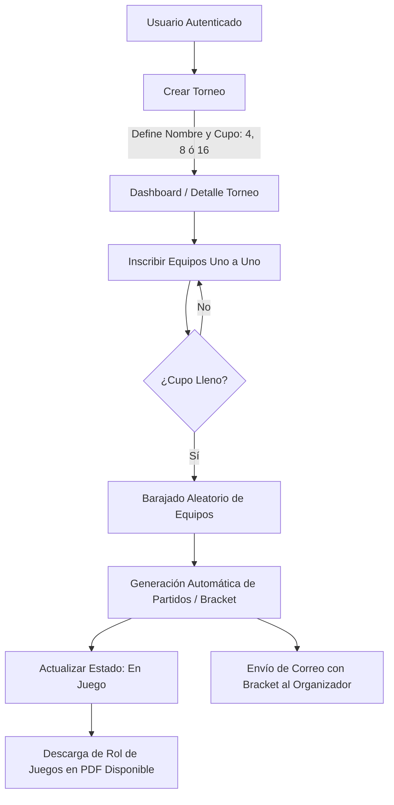

# ⚽ Sistema de Gestión de Torneos de Fútbol

Proyecto Web desarrollado en **Laravel** para la administración, registro y seguimiento de torneos deportivos con generación automática de brackets eliminatorios, exportación de roles de juego en formato PDF y notificaciones por correo electrónico.

---

## 📌 Tabla de Contenidos

- [Características Principales](#-características-principales)
- [Tecnologías Utilizadas](#-tecnologías-utilizadas)
- [Arquitectura y Análisis de Vistas](#-arquitectura-y-análisis-de-vistas)
  - [1. Dashboard Principal](#1-dashboard-principal-resourcesviewsdashboardbladephp)
  - [2. Módulo de Torneos](#2-módulo-de-torneos-resourcesviewstournaments)
  - [3. Notificaciones por Correo Electrónico](#3-notificaciones-por-correo-electrónico-resourcesviewsemails)
  - [4. Layouts y Navegación](#4-layouts-y-navegación-resourcesviewslayouts)
  - [5. Autenticación y Perfil de Usuario](#5-autenticación-y-perfil-de-usuario-resourcesviewsauth--profile)
  - [6. Componentes Blade Reutilizables](#6-componentes-blade-reutilizables-resourcesviewscomponents)
- [Flujo de Funcionamiento del Sistema](#-flujo-de-funcionamiento-del-sistema)
- [Estructura de Base de Datos](#-estructura-de-base-de-datos)
- [Requisitos del Sistema](#-requisitos-del-sistema)
- [Instalación y Puesta en Marcha](#-instalación-y-puesta-en-marcha)
- [Estructura del Proyecto](#-estructura-del-proyecto)

---

## 🚀 Características Principales

- **Gestión Integral de Torneos:** Creación de torneos con formatos configurables de **4, 8 y 16 equipos**.
- **Inscripción Dinámica de Equipos:** Registro progresivo de participantes con control de cupos en tiempo real.
- **Generación Automática de Brackets (Cruces):** Al completarse el cupo máximo, el sistema baraja aleatoriamente los equipos y genera automáticamente los enfrentamientos de la primera ronda eliminatoria (Octavos, Cuartos o Semifinales).
- **Notificaciones por Email:** Envío de correo automático al organizador cuando el torneo completa su cupo con la tabla de cruces generados.
- **Exportación en PDF:** Generación y descarga directa del rol de juegos y estado del torneo maquetado para impresión.
- **Autenticación Segura:** Sistema de acceso y control de perfiles basado en Laravel Breeze.
- **Interfaz Moderna y Responsiva:** Diseño estilizado con Tailwind CSS y Alpine.js para una experiencia fluida tanto en escritorio como en dispositivos móviles.

---

## 🛠️ Tecnologías Utilizadas

- **Backend:** [PHP 8.2+](https://www.php.net/), [Laravel 12](https://laravel.com/)
- **Frontend:** [Blade Templates](https://laravel.com/docs/blade), [Tailwind CSS](https://tailwindcss.com/), [Alpine.js](https://alpinejs.dev/), [Vite](https://vite.dev/)
- **Generación de Documentos:** [barryvdh/laravel-dompdf](https://github.com/barryvdh/laravel-dompdf)
- **Mailing:** [Laravel Mailables & Markdown Mail](https://laravel.com/docs/mail)
- **Base de Datos:** PostgreSQL / MySQL / SQLite (vía Eloquent ORM)
- **Autenticación:** [Laravel Breeze](https://laravel.com/docs/starter-kits#laravel-breeze)

---

## 🖥️ Arquitectura y Análisis de Vistas

El sistema organiza su capa de presentación bajo el directorio `resources/views/`, desacoplando la lógica de componentes, plantillas base y pantallas del negocio:

### 1. Dashboard Principal (`resources/views/dashboard.blade.php`)
- **Propósito:** Vista inicial del usuario autenticado que actúa como centro de control.
- **Elementos Clave:**
  - **Mensajes Flash:** Alertas de confirmación de operaciones (`session('success')`).
  - **Grid de Torneos:** Tarjetas visuales interactivas que reflejan el estado del torneo:
    - Borde verde y badge `En Juego` cuando el torneo ya inició y tiene cruces activos.
    - Borde amarillo y badge `Inscripciones Abiertas` cuando aún hay plazas disponibles.
    - Métrica de progreso de equipos inscritos (`actuales / max_teams`) y fecha de creación.
  - **Empty State:** Indicador visual amigable cuando no existen torneos registrados, con llamado a la acción para crear uno nuevo.

### 2. Módulo de Torneos (`resources/views/tournaments/`)

| Archivo | Descripción y Funcionalidad |
| :--- | :--- |
| **`create.blade.php`** | Formulario para dar de alta un nuevo torneo. Permite especificar el nombre y el formato del torneo mediante un selector de llaves eliminatorias: **4 Equipos** (Semifinal y Final), **8 Equipos** (Cuartos, Semifinal y Final) o **16 Equipos** (Octavos a Final). Incluye validaciones integradas. |
| **`show.blade.php`** | Vista principal de detalle y operación del torneo dividida en dos paneles: <br>• **Columna de Control (Izquierda):** Resumen de estado, contador de avance, lista de participantes inscritos y formulario dinámico para registrar nuevos equipos (oculto automáticamente una vez iniciado el torneo). <br>• **Cuadro del Torneo / Bracket (Derecha):** Presenta visualmente los cruces agrupados por rondas ('Octavos de Final', 'Cuartos de Final', 'Semifinal', 'Final'), con los equipos locales y visitantes y el resaltado visual de ganadores. <br>• **Acción PDF:** Botón superior para descargar el rol oficial generado cuando el torneo se encuentra en juego. |
| **`pdf.blade.php`** | Plantilla optimizada para renderizado e impresión mediante DomPDF. Genera un reporte limpio con título, formato, estado, listado completo de participantes y tablas tabulares para cada ronda de partidos (`Local` vs `Visitante`), previniendo saltos de página inadecuados (`page-break-inside: avoid`). |

### 3. Notificaciones por Correo Electrónico (`resources/views/emails/`)
- **`bracket-generated.blade.php`:**
  - Plantilla de correo en formato Markdown generada mediante `BracketGeneratedMail`.
  - Notifica al organizador en el momento exacto en que el torneo alcanza su cupo máximo.
  - Presenta una tabla estilizada con los primeros enfrentamientos emparejados y un botón de enlace directo (`x-mail::button`) para acceder al torneo en el sistema.

### 4. Layouts y Navegación (`resources/views/layouts/`)
- **`app.blade.php`:** Layout maestro para usuarios autenticados. Importa fuentes tipográficas (Figtree), assets de Vite (`app.css`, `app.js`), meta tags de CSRF, la barra de navegación y las secciones de encabezado y contenido dinámico (`$header`, `$slot`).
- **`guest.blade.php`:** Plantilla minimalista para flujos no autenticados (inicio de sesión, registro, recuperación de contraseña).
- **`navigation.blade.php`:** Barra superior que contiene el logotipo del sistema, enlaces de navegación directa (Dashboard, Nuevo Torneo), menú desplegable de usuario con acceso al perfil y cierre de sesión, junto con un menú colapsable adaptado para pantallas móviles.

### 5. Autenticación y Perfil de Usuario (`resources/views/auth/` & `resources/views/profile/`)
- **Módulo `auth/`:** Flujo completo de registro (`register.blade.php`), inicio de sesión (`login.blade.php`), restablecimiento de contraseñas (`forgot-password.blade.php`, `reset-password.blade.php`) y verificación.
- **Módulo `profile/`:** Edición de credenciales de usuario, cambio seguro de contraseña y eliminación de cuenta.

### 6. Componentes Blade Reutilizables (`resources/views/components/`)
La aplicación implementa un catálogo de componentes atómicos para consistencia visual:
- Botones: `primary-button`, `secondary-button`, `danger-button`.
- Formularios: `text-input`, `input-label`, `input-error`.
- Navegación y UI: `nav-link`, `responsive-nav-link`, `dropdown`, `dropdown-link`, `modal`, `application-logo`.

---

## 🔄 Flujo de Funcionamiento del Sistema



---

## 🗄️ Estructura de Base de Datos

El sistema modela las siguientes entidades principales mediante migraciones y relaciones Eloquent:

- **Users:** Usuarios administradores y organizadores con credenciales de acceso.
- **Tournaments:**
  - `id`: Identificador único.
  - `name`: Nombre del torneo.
  - `max_teams`: Capacidad máxima de participantes (4, 8, 16).
  - `is_started`: Estado de inicio del torneo (booleano).
- **Teams:**
  - `id`: Identificador único.
  - `name`: Nombre del equipo.
  - `tournament_id`: Clave foránea referenciando a `tournaments`.
- **GameMatches:**
  - `id`: Identificador único.
  - `tournament_id`: Clave foránea al torneo.
  - `home_team_id`: Clave foránea al equipo local.
  - `away_team_id`: Clave foránea al equipo visitante.
  - `winner_id`: Clave foránea al equipo vencedor (opcional).
  - `round`: Nombre de la ronda ('Octavos de Final', 'Cuartos de Final', 'Semifinal', 'Final').

---

## 📋 Requisitos del Sistema

- **PHP:** >= 8.2
- **Composer:** >= 2.x
- **Node.js:** >= 18.x & **NPM**
- **Base de Datos:** PostgreSQL, MySQL, MariaDB o SQLite
- **Extensiones PHP:** `pdo`, `mbstring`, `openssl`, `gd` (requerida por DomPDF)

---

## ⚙️ Instalación y Puesta en Marcha

Sigue los pasos a continuación para desplegar el proyecto en un entorno local:

### 1. Clonar el repositorio
```bash
git clone https://github.com/CesarRdzG/Proyecto-Final-Web-.git
cd Proyecto-Final-Web-
```

### 2. Instalar dependencias de PHP y Node.js
```bash
composer install
npm install
```

### 3. Configurar variables de entorno
Copia el archivo `.env.example` a `.env`:
```bash
cp .env.example .env
```

Configura tus credenciales de base de datos y de correo en `.env`:
```env
DB_CONNECTION=pgsql
DB_HOST=127.0.0.1
DB_PORT=5432
DB_DATABASE=torneo_futbol
DB_USERNAME=tu_usuario
DB_PASSWORD=tu_contraseña

MAIL_MAILER=log # O configurar SMTP (Mailtrap, Gmail, etc.)
```

### 4. Generar clave de aplicación y ejecutar migraciones
```bash
php artisan key:generate
php artisan migrate
```

### 5. Compilar assets y levantar el servidor
Para desarrollo con recarga en vivo de Vite y servidor PHP:
```bash
npm run dev
php artisan serve
```
O bien ejecutar ambos procesos concurrentemente:
```bash
composer run dev
```

Accede a la aplicación en tu navegador web ingresando a:
```
http://127.0.0.1:8000
```

---

## 📁 Estructura del Proyecto

```text
├── app/
│   ├── Http/Controllers/
│   │   ├── ProfileController.php      # Control de perfiles de usuario
│   │   └── TournamentController.php   # Lógica de torneos, cruces y reportes
│   ├── Mail/
│   │   └── BracketGeneratedMail.php   # Mailable de cruces generados
│   └── Models/
│       ├── GameMatch.php              # Modelo de partidos y rondas
│       ├── Team.php                   # Modelo de equipos
│       ├── Tournament.php             # Modelo de torneos
│       └── User.php                   # Modelo de usuarios
├── database/
│   └── migrations/                    # Definición de tablas y claves foráneas
├── resources/
│   ├── css/
│   ├── js/
│   └── views/                         # Capa de presentación (Blade)
│       ├── auth/                      # Vistas de autenticación Breeze
│       ├── components/                # Componentes Blade reutilizables
│       ├── emails/                    # Plantillas de correos electrónicos
│       ├── layouts/                   # Layouts principales (app, guest, nav)
│       ├── profile/                   # Vistas de configuración de perfil
│       ├── tournaments/               # Vistas de gestión de torneos y PDF
│       └── dashboard.blade.php        # Panel principal de control
└── routes/
    ├── auth.php                       # Rutas de autenticación
    └── web.php                        # Rutas principales de la aplicación
```

---

## 📄 Licencia

Este proyecto fue desarrollado con propósitos académicos y de libre distribución bajo la licencia [MIT](LICENSE).
